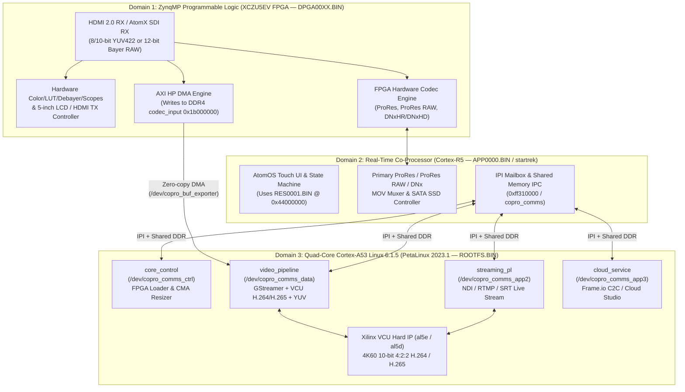

# Phase 1 Deliverable: Atomos Ninja V System & Software Architecture Report (`AtomOS 11.19.00`)

- **Project:** Verdanove Ninja Lab
- **Target Device:** Original Atomos Ninja V (5-inch model)
- **Firmware Baseline:** AtomOS `11.19.00` (`ATOMNJV.FW`)
- **Verified SoC:** **Xilinx Zynq UltraScale+ MPSoC `XCZU5EV`** (`compatible = "atms,ninjav", "xlnx,zynqmp"`)

---

## 1. High-Level Asymmetric Multiprocessing (AMP) Architecture

Static reverse engineering of `system.dtb`, `APP0000.BIN`, `DPGA00XX.BIN`, and the `ext4` root filesystem proves that the Atomos Ninja V is **not** a purely Linux-driven recorder. Instead, it is a tightly coupled **3-domain Asymmetric Multiprocessing (AMP) system** sharing 2 GiB of physical DDR4 memory (`0x00000000`–`0x7FFFFFFF`):

---

## 2. Physical DDR4 Memory Map (2 GiB Total: `0x00000000`–`0x7FFFFFFF`)

Derived directly from `reverse-engineering/device-tree/system.dts` (`/memory@0` and `/reserved-memory`), `/etc/init.d/init_mem_layout.sh`, and the ZynqMP Partition Headers of `APP0000.BIN` and `RES0001.BIN`:

| Physical Address Range | Size | Device Tree Node / Owner | Attributes | Architectural Role |
|---|---:|---|---|---|
| `0x00000000` – `0x19FFFFFF` | `416 MiB` | `/memory@0` (Linux Kernel & Userspace) | Normal System RAM | Linux `6.1.5` kernel (`0x00200000`), rootfs page cache, GStreamer, and Atomos userspace daemons |
| `0x1A000000` – `0x1AFFFFFF` | `16 MiB` | `misc_cma: buffer@0x1a000000` | `shared-dma-pool`, `reusable`, `linux,cma-default` | Default Linux Contiguous Memory Allocator (CMA) for standard drivers |
| `0x1B000000` – `0x2BFFFFFF` | `272 MiB` | `codec_input: buffer@0x1b000000` | `atomos_reserved`, `no-map` | **Shared Zero-Copy Video Frame Buffer Pool.** FPGA/R5 writes captured frames here; exported to Linux `video_pipeline`/`streaming_pl` as `dma_buf` FDs via `/dev/copro_buf_exporter` |
| `0x2C000000` – `0x5FFFFFFF` | `832 MiB` | `codec_output: buffer@0x2c000000` | `custom_cma`, `reusable` | **Dynamic VCU & CoPro Shared Pool.** Managed by `custom-cma.ko` (`/sys/devices/platform/custom_cma/resize`). Resized dynamically between R5/UI/RES0001 (`0x44000000`) and Linux VCU (`al5e`/`al5d`) |
| `0x60000000` – `0x7FFFFFFF` | `512 MiB` | Excluded from Linux `/memory@0` (Owned by Cortex-R5) | RPU Exclusive DDR | Dedicated to the **Cortex-R5 (`APP0000.BIN` / `startrek_noresources.elf`)**, loaded at `0x64cb7238`, plus R5 heap and FPGA hardware ProRes/DNx ring buffers |

---

## 3. Hardware Peripherals & AXI Address Map (`system.dts`)

| Physical Base Address | Size | Compatible / Driver | Description |
|---|---:|---|---|
| `0x82000000` (`0x820010DC`) | `64 KiB` | Custom PL AXI-Lite | ZynqMP FPGA bitstream identification (`0x820010DC` = `type_id`) and control registers |
| `0xA0000000` – `0xA01FFFFF` | `2 MiB` | `al5e`, `al5d`, `xlnx,vcu` | **Xilinx Video Codec Unit (VCU)** hard IP block (`al5e@a0000000` encoder, `al5d@a0020000` decoder, `vcu@a0040000` logicoreIP) |
| `0xFF000000` | `4 KiB` | `cdns,uart-r1p12` (`serial0`) | UART0 console (`115200n8`, `ttyPS0`) |
| `0xFF010000` | `4 KiB` | `cdns,uart-r1p12` (`serial1`) | UART1 (`ttyPS1`, LANC / EFM32 Gecko / internal MCU interface) |
| `0xFF020000` / `0xFF030000` | `4 KiB` | `cdns,i2c-r1p14` | I2C0 and I2C1 buses (PMIC, HDMI RX/TX, touch controller, audio codec, temp sensors) |
| `0xFF0E0000` | `4 KiB` | `cdns,zynqmp-gem` (`gem3`) | Gigabit Ethernet MAC (`eth0`, used with AtomX CAST / Atomos Connect) |
| `0xFF0F0000` | `4 KiB` | `xlnx,zynqmp-qspi-1.0` | Quad-SPI Flash controller (`spi0`, stores 2 MiB primary `sec4` / 22 MiB recovery `sec5` boot images and U-Boot environment at `0x1E0000`) |
| `0xFF160000` | `4 KiB` | `arasan,sdhci-8.9a` (`sdhci0`) | Internal 4 GB eMMC (`mmcblk0`: `p1`=`/boot` FAT16, `p2`=`/` ext4, `p3`=`/atomos` ext4) |
| `0xFF170000` | `4 KiB` | `arasan,sdhci-8.9a` (`sdhci1`) | SDIO bus (`mmc1`, Wi-Fi/BT module on Atomos Connect) |
| `0xFF310000` | `64 KiB` | `xlnx,zynqmp-ipi-mailbox` | Inter-Processor Interrupt (IPI) hardware mailbox between Cortex-A53 and Cortex-R5 |
| `0xFD0C0000` | `8 KiB` | `ceva,ahci-1v84` (`sata`) | ZynqMP integrated SATA 3.0 AHCI controller (Master Caddy II / AtomX SSDmini slot) |
| `0xFE200000` | `64 KiB` | `snps,dwc3` (`usb0`) | USB 3.0 Dual-Role Controller |

---

## 4. Key Architectural Conclusions & Constraints for Phase 2–5

1. **Why ProRes, ProRes RAW, and DNxHR Run Effortlessly on Ninja V:**
   - They are **not** encoded on the CPU or the VCU. They are encoded by dedicated, mode-specific **ZynqMP FPGA bitstreams (`DPGA0002.BIN`, `DPGA0003.BIN`, `DPGA0005.BIN`, `DPGA0012.BIN`)** managed by the **Cortex-R5 (`APP0000.BIN`)**.
2. **Why `DPGA00XX.BIN` and `APP0000.BIN` Cannot Be Trivially Modified:**
   - All 16 `DPGA00XX.BIN` bitstreams and `APP0000.BIN` have ZynqMP Partition Header attribute `0x80` set with Key Source `0xA5C3C5A3` (`EFUSE_RED_KEY`). Unless the hardware AES-256 key fused into the Ninja V's eFUSE is extracted or bypassed, custom FPGA bitstreams or modified `APP0000.BIN` images signed/encrypted with a different key will be rejected by the CSU hardware decryptor unless booted in an unencrypted partition header mode (to be investigated in Phase 2/3).
3. **Why the Linux Side (`FLASH.UB`, `RAMDISK.UB`, `ROOTFS.BIN`, `video_pipeline`) Is Wide Open:**
   - The Linux kernel, device tree, initramfs, and `ext4` root filesystem are **completely unencrypted**.
   - Furthermore, when an H.265/VCU bitstream (`DPGA0009.BIN` / `cp_h265.bit`) is active, the FPGA transfers uncompressed captured frames directly into `codec_input` (`0x1b000000`–`0x2c000000`) and notifies Linux `video_pipeline` over `/dev/copro_comms_data`.
   - However, it remains to be verified in **Phase 2 & Phase 3** whether `cp_h265.bit` (`DPGA0009.BIN`) or `prraw_cp_app.bit` (`DPGA0005.BIN`) can expose **12-bit Bayer RAW** frames to Linux in `codec_input`, or whether `cp_h265.bit` only transfers 8-bit/10-bit 4:2:2 YUV (`nv16` / `nv16_10le32`) and whether 4x Cortex-A53 @ 1.2 GHz has sufficient compute and memory bandwidth for real-time Blue Compressor / TICO-RAW encoding.
